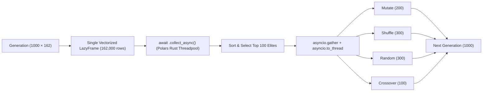
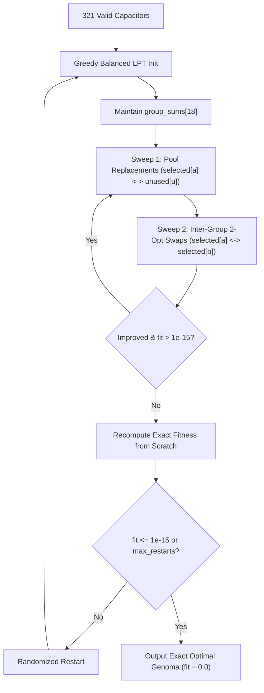

# Capacitor Balance — Architecture & Algorithm Design

This document traces the design evolution of the Capacitor Balance solver across three stages:

1. **Initial Python + Polars implementation** (eager per-genoma DataFrame evaluation & async-generator GA)
2. **Optimized Python + Polars implementation** (vectorized `LazyFrame.collect_async()`, concurrent offspring generation, and $O(N)$ set operations)
3. **Native Mojo implementation** (`mojo_solver/solver.mojo`) in two modes:
   - **`--mode ga`**: faithful genetic-algorithm parity with Python on flat memory + SIMD
   - **`--mode fast`**: greedy LPT initialization + incremental 2-opt local search achieving the exact global optimum (`0.0`)

---

## 1. Problem Formulation

This project is a **3-phase series-parallel capacitor bank balancer**. In a high-voltage 3-phase capacitor bank (phases **A, B, and C**), manufacturing tolerances cause individual capacitor units to deviate slightly from their nominal capacitance. To achieve near-zero unbalance across phases **A, B, and C**—and uniform capacitance across the series-connected parallel groups within each phase—units must be selected and arranged so that all three phases exhibit nearly identical equivalent capacitance.

The input database (`src/capacitor_balance/capacitors.db`) contains 324 rows representing measured physical capacitors (321 valid rows with non-`NULL` capacitance values in `[1.010, 1.037]`, and 3 rows with `NULL` capacitance).

The goal is to choose an ordered sequence (**genoma**) of **$N = 162$ distinct capacitors** arranged into the 3-phase series-parallel bank topology:

```text
3 Phases: A (p = 0), B (p = 1), C (p = 2)
 └── 6 Series Groups per phase (s = 0..5)  → 18 parallel groups total (g = 0..17)
      └── 9 Capacitors in parallel per group (k = 0..8)  → 162 capacitors total
```

### Objective Function (Fitness to Minimize)

1. **Parallel group capacitances** (sum of 9 capacitors in parallel, for $g \in \{0, \dots, 17\}$):
   $$P_g = \sum_{k=0}^{8} C_{9g + k}$$
2. **Parallel group sample standard deviation** (`ddof = 1`, balancing voltage/capacitance sharing across all 18 series-connected parallel groups):
   $$\sigma_{\text{parallel}} = \sqrt{\frac{1}{17} \sum_{g=0}^{17} (P_g - \bar{P})^2}$$
3. **Series phase capacitances** (reciprocal sum of 6 parallel groups in series for each phase $p \in \{\text{A}, \text{B}, \text{C}\}$):
   $$S_p = \left(\sum_{s=0}^{5} \frac{1}{P_{6p + s}}\right)^{-1}$$
4. **Phase-to-phase sample standard deviation** (`ddof = 1`, balancing equivalent capacitance across phases A, B, and C):
   $$\sigma_{\text{phase}} = \sqrt{\frac{1}{2} \sum_{p \in \{A, B, C\}} (S_p - \bar{S})^2}$$
5. **Weighted fitness score**:
   $$F = 20 \cdot \sigma_{\text{phase}} + \sigma_{\text{parallel}}$$

**Key mathematical insight:** Phase-to-phase unbalance across phases A, B, and C is weighted $20\times$ more heavily than internal parallel-group variance. However, when all 18 parallel group sums are equal ($P_0 = P_1 = \dots = P_{17} = P^*$), $\sigma_{\text{parallel}} = 0$ **and** all three phases (A, B, and C) achieve the exact same equivalent capacitance $S_A = S_B = S_C = P^* / 6$, yielding $\sigma_{\text{phase}} = 0$ and $F = 0.0$ simultaneously (perfect zero unbalance).

---

## 2. Stage 1 — Initial Python Implementation

The initial version in [src/capacitor_balance/functional_program.py](src/capacitor_balance/functional_program.py) modeled the problem as a **Genetic Algorithm (GA)** with Polars DataFrames for evaluation and manipulation.

### How the Genetic Algorithm Searches

- **Representation**: Each genoma is a `list[Capacitor]` of 162 `TypedDict` records (`idx`, `serial`, `cap`), and a generation holds `GENERATION_LENGTH = 1000` genomas evolved over `ITERATIONS = 500` generations.
- **Per-generation transition** (`update_generation`):
  1. Score every genoma with `fitness(gen)` and sort ascending.
  2. Build the next 1,000-genoma generation from five fixed slices:
     - **Elitism (10% / 100)**: keep the top 100 genomas unchanged.
     - **Mutation (20% / 200)**: pick a random elite, find all capacitors not currently in that genoma (`possible_options`), and replace 1 random slot with an unused capacitor.
     - **Shuffle (30% / 300)**: pick a random elite and randomly permute its 162 capacitors across groups/phases (preserving the same multiset of capacitors while exploring new groupings).
     - **Crossover (10% / 100)**: pair a random elite `g1` with a random member `g2` of the previous generation; at each index, take `g2[i]` with 50% probability only if `g2[i]` does not already appear in `g1` (preventing duplicates).
     - **Random immigration (30% / 300)**: sample 300 brand-new 162-capacitor genomas to maintain diversity.

### Bottlenecks in the Initial Version

- **Per-genoma eager Polars construction**: `fitness(gen)` built a new 162-row `pl.DataFrame(gen)` **1,000 times per iteration** sequentially (`~0.49 s` per iteration just for fitness evaluation).
- **Inner-loop DataFrame anti-joins**:
  - `possible_options()` built two DataFrames and ran an anti-join 200 times per iteration.
  - `crossover_genoma()` built two DataFrames and ran an anti-join + linear list membership scan 100 times per iteration.
  - `random_genoma()` converted all 324 options to a DataFrame and called `.sample()` 300 times per iteration.
- **Sequential async overhead**: `_aiter` wrapped synchronous Python lists in an async generator without performing any real I/O or parallel work, and `mutated`, `shuffled`, `random`, and `crossovered` were awaited one after another.

---

## 3. Stage 2 — Vectorized Async Polars & Concurrent Python Refactor

To unlock Polars' internal Rust parallelism and real `asyncio` concurrency while preserving the exact same GA semantics (commit `3d2d7b1`), the Python implementation was refactored around four changes:



### Key Optimizations

1. **Single vectorized `pl.LazyFrame` + `.collect_async()` (`evaluate_generation`)**:
   - Instead of 1,000 separate 162-row DataFrames—or `pl.collect_all_async` over 1,000 tiny `LazyFrame`s, which benchmarked **275× slower** (`13.29 s` vs. `0.048 s`) due to per-plan scheduling overhead—the entire generation is flattened into one 162,000-row `LazyFrame` with columns `("gen_id", "par_id", "cap")`.
   - Polars executes the grouped parallel sums, window `.std().over("gen_id")`, series reductions, and final aggregation in parallel across CPU cores inside a single Rust query plan, awaited via `.collect_async()`.
   - This alone cut 1,000-genoma evaluation time by **~10×** (`0.488 s → 0.048 s`).
   - `sort_generation()` returns `(sorted_generation, best_fitness)` so the best score isn't recomputed a second time per iteration.

2. **True concurrent offspring generation**:
   - Removed the `_aiter` overhead wrapper.
   - `update_generation()` dispatches `mutated_genomas`, `shuffled_genomas`, `random_genomas`, and `crossovered_genomas` concurrently using `await asyncio.gather(asyncio.to_thread(...), ...)`.

3. **$O(N)$ Python set operations replacing inner-loop DataFrames**:
   - `get_df()` attaches a globally unique row index via `.with_row_index("idx")` (also resolving a data edge case where `capacitors.db` has duplicate `"N° DE SERIE"` values on rows 9 & 36 and on the 3 `NULL` rows).
   - `possible_options()` and `crossover_genoma()` use `{cap["idx"] for cap in gen}` set lookups ($O(N)$), `random_genoma()` uses `random.sample()`, and `mutation_genoma()` copies and mutates a single index directly.

4. **Measured Outcome**:
   - Full 500-iteration run completes in **18.43 s** mean wall time (median `18.27 s`), converging to a mean fitness of **`6.82 × 10⁻⁴`** (best `5.94 × 10⁻⁴`).

---

## 4. Stage 3 — Native Mojo Solver (`mojo_solver/solver.mojo`)

The Mojo implementation ([mojo_solver/solver.mojo](mojo_solver/solver.mojo)) eliminates interpreter overhead, per-iteration memory allocations, and Python startup costs while exposing **two solver modes** sharing the same exact fitness evaluator and native I/O layer.

### Shared Native Infrastructure

- **Direct `libsqlite3` FFI (`load_capacitors`)**: Loads `capacitors.db` via `OwnedDLHandle("libsqlite3.dylib")` (or `libsqlite3.so.0` on Linux), filtering out the 3 `NULL`-capacitance rows directly into flat Struct-of-Arrays (`CapacitorData`). Zero CPython initialization.
- **Zero-allocation SIMD-4 exact fitness (`fitness_from_group_sums`)**:
  - Uses `Array[Float64, 18]` (stack-allocated) and unrolled `SIMD[.float64, 4]` arithmetic for parallel group means, squared deviations, and reciprocal sums.
  - Uses **two-pass variance** ($\frac{1}{n-1}\sum (x_i - \bar{x})^2$) rather than one-pass ($\mathbb{E}[x^2] - \mathbb{E}[x]^2$) so rounding error never causes catastrophic cancellation when variance approaches `0.0` around $P_g^2 \approx 84.8$.
- **Thread-safe fast PRNG (`Rng`)**: `TrivialRegisterPassable` SplitMix64-seeded XorShift64\* generator living in a single 64-bit register.

---

### Mode A: Mojo GA (`--mode ga`) — Exact Algorithm Parity

`run_ga()` implements the exact same `1,000` population × `500` iterations genetic algorithm as Python (`100` elite / `200` mutation / `300` shuffle / `100` crossover / `300` random) to provide an apples-to-apples language & memory-layout benchmark:

- **Double-buffered flat populations**: Two pre-allocated contiguous `List[Int32]` buffers (`pop_a`, `pop_b`) of size `1000 × 162 = 162,000` (`Int32` indices into the capacitance table). Buffers are swapped each generation (`swap(pop_a, pop_b)`), resulting in **zero heap allocations** inside the 500-iteration loop.
- **Unrolled evaluation (`compute_fitness`)**: Sums each 9-capacitor group directly from `Span[Int32]` + `Span[Float64]` into a stack `Array[Float64, 18]` and invokes `fitness_from_group_sums`.
- **$O(1)$ monotonic stamp-array membership**: Instead of allocating hash sets per mutation or crossover, a single `used_stamp: List[Int32]` array is reused across all 500 iterations by incrementing a `stamp` counter. Checking whether capacitor `c` is in a parent is a single array compare (`used_stamp[c] == stamp`).
- **In-place Fisher-Yates sampling & shuffling**: `fill_random_genoma()` performs a partial 162-step Fisher-Yates shuffle on an index pool; shuffle offspring permute directly inside `pop_b`.

**How it finds its combination:** Exactly like Python's GA—stochastic exploration guided by 10% elitist selection. Because random full-genoma shuffles and single-gene random mutations rarely cancel small residual differences across all 18 groups simultaneously, both Python GA and Mojo GA converge to the same accuracy regime (`~6–7 × 10⁻⁴`, verified within `7.3 × 10⁻¹⁵` of Python's evaluator), while Mojo runs **55× faster wall / 61× faster solve** (`0.334 s` / `0.304 s` vs. `18.43 s`).

---

### Mode B: Mojo Fast (`--mode fast`) — Greedy LPT + Incremental 2-Opt Local Search

Because the genetic algorithm's accuracy ceiling (`~6 × 10⁻⁴`) is an **algorithmic** bottleneck rather than a numerical limit of the dataset, `run_fast_solver()` replaces random population search with a structured **construct-and-refine** algorithm designed for the additive structure of parallel groups:



#### Step-by-Step: How It Finds the Global Optimum

1. **Greedy Balanced LPT Initialization (`greedy_balanced_init`)**:
   - On restart `0`, all 321 capacitors are sorted by capacitance and the **middle 162 capacitors** (around the median, minimizing intrinsic spread) are chosen as the initial candidate set; the remaining 159 form the `unused` pool. (On restarts `> 0`, a random subset of 162 is chosen for diversification.)
   - The 162 chosen capacitors are sorted descending and assigned via **Longest-Processing-Time (LPT)** packing: each capacitor is placed into whichever of the 18 parallel groups currently has the smallest sum and fewer than 9 capacitors.
   - This single deterministic pass takes microseconds and already yields a tightly balanced starting state.

2. **Incremental $O(1)$ Local Search Sweeps**:
   - Rather than re-summing all 162 capacitors on every trial move, the solver maintains `group_sums: Array[Float64, 18]` incrementally:
     - **Pool-replacement sweep**: For each selected position `pos_a` in group `g`, test replacing it with every unused capacitor `u` in the remaining 159 capacitors. Only `group_sums[g]` changes (`old_sum_g - cap_a + cap_u`). Pick the best improving replacement and commit it immediately.
     - **Inter-group 2-opt swap sweep**: For each pair of positions `(pos_a, pos_b)` in distinct groups `g1 < g2`, test swapping them. Only `group_sums[g1]` and `group_sums[g2]` change (`+delta` and `-delta`). Pick the best improving swap and commit it immediately.
   - Each candidate move evaluates exact two-pass SIMD-4 `fitness_from_group_sums(group_sums)` in **~25 ns** (~20–30 FLOPs, zero allocations).

3. **Drift-Free Verification & Early Exit**:
   - Sweeps repeat until no improving swap or replacement exists or `cur_fit <= 1e-15`.
   - At the end of a restart, `compute_fitness()` recomputes the full score from scratch from `selected[0..161]` to guarantee zero accumulated floating-point drift.
   - If the target (`<= 1e-15`) is reached, the solver exits immediately; otherwise it triggers a randomized restart (up to `max_restarts = 64`) to escape local minima.

4. **Measured Outcome**:
   - On `capacitors.db`, `run_fast_solver()` reaches **`fitness = 0.0`** in **3 sweeps** (`1.46 ms` solve time / `17.7 ms` full OS process wall time — **1,043× faster wall** and **12,666× faster compute** than Python/Polars).
   - Every one of the 18 parallel groups sums to **exact `9.209000000000`**, every one of the 3 series phases equals **exact `1.534833333333`**, and Python's own unmodified `evaluate_generation()` confirms `0.0000000000000000e+00`.

---

### Mode C: Alternative Mojo Residual Balancer (`mojo_solver/residual_solver.mojo`)

While `solver.mojo --mode fast` reaches `0.0` in `1.46 ms`, it still scans all $162 \times 159 = 25,758$ pool replacements and $\binom{18}{2} \times 81 = 12,393$ inter-group pairs per sweep, evaluating full 18-group `std` on every candidate.

[mojo_solver/residual_solver.mojo](mojo_solver/residual_solver.mojo) takes a completely different, algebraic approach that eliminates exhaustive scans and removes every `sqrt` call from the inner loop:

1. **Tightest-Window Selection**: Sorts the 321 valid capacitors once and picks the contiguous 162-unit slice with minimum range (`[1.019, 1.025]`, spread `0.006`), minimizing unit-to-unit capacitance spread inside parallel groups.
2. **Snake (Boustrophedon) + LPT Packing**: Places the first 8 layers (144 units) in alternating left-to-right / right-to-left order ($O(1)$ per unit) and packs the final 9th layer inversely against the sorted partial sums.
3. **Algebraic Max-Min Cancellation + $O(\log M)$ Binary-Searched Pool Matching**:
   - In each iteration, identifies only the single heaviest group ($g_{\max}$) and lightest group ($g_{\min}$).
   - Evaluates at most **81 pairs** between $g_{\max}$ and $g_{\min}$ using the exact algebraic SSE delta $\Delta \text{SSE} = 2\delta(\delta - (P_{\max} - P_{\min}))$ (zero `sqrt`, zero 18-group loops).
   - Simultaneously probes the sorted unused pool via **binary search** (`~8` comparisons per slot) for the exact ideal replacement capacitance $c_{\text{old}} - (P_g - \bar{P}) / (1 - 1/18)$ on $g_{\max}$ and $g_{\min}$, maintaining sorted order in-place via local shifts.
   - Commits whichever move produces the largest exact SSE reduction, stopping as soon as $P_{\max} - P_{\min} \le 10^{-15}$.
4. **Phase A/B/C Reciprocal Balancing (`balance_phases_by_reciprocal`)**: If any non-zero parallel group spread remains (e.g., on noisy continuous float measurements), assigns the 18 groups across Phases A, B, and C via LPT + 2-opt on $1/P_g$ to equalize series phase capacitances without disturbing parallel group sums.

**Measured Outcome**: Converges in **10 moves** to exact `0.000` parallel and phase spread (all 18 groups = `9.202`, all 3 phases A/B/C = `1.533666666667`, Python evaluator `1.67 × 10⁻¹⁵`) in **36.2 µs cold / 19.7 µs warm** — **40–74× faster** than `solver.mojo --mode fast` and **>500,000× faster** in compute time than Python/Polars.

---

## 5. Summary Comparison

| Dimension | Stage 1: Initial Python | Stage 2: Optimized Python | Stage 3A: Mojo GA | Stage 3B: Mojo Fast | Stage 3C: Mojo Residual |
|---|---|---|---|---|---|
| **Algorithm** | GA (1000 × 500) | GA (1000 × 500) | GA (1000 × 500) | Greedy LPT + 2-opt & Pool Local Search | Tightest-Window Snake + Algebraic Residual & Phase Reciprocal |
| **Evaluation Engine** | Eager `pl.DataFrame` per genoma | Single 162k-row `pl.LazyFrame.collect_async()` | Flat `List[Int32]` + SIMD-4 `Float64` | Incremental `group_sums[18]` + SIMD-4 `Float64` | Algebraic $\Delta\text{SSE}$ + $O(\log M)$ binary search (zero `sqrt`) |
| **Uniqueness Check** | Polars anti-joins | Python `set` on `idx` | $O(1)$ stamp array (`List[Int32]`) | Partitioned `selected[162]` + `unused[159]` | Sorted `chosen[162]` + sorted `unused[159]` |
| **Database I/O** | Python `sqlite3` + Polars | Python `sqlite3` + Polars | Native `libsqlite3` FFI | Native `libsqlite3` FFI | Native `libsqlite3` FFI |
| **Mean Wall Time** | ~600 s *(projected)* | **18.43 s** | **0.334 s** *(55.2×)* | **17.7 ms** *(1,043×)* | **14.6 ms** *(1,267×)* |
| **Mean Solve Time** | ~600 s *(projected)* | ~18.4 s | **0.304 s** *(60.6×)* | **1.46 ms** *(12,666×)* | **36.2 µs** cold / **19.7 µs** warm |
| **Mean Best Fitness** | `~6–10 × 10⁻⁴` | `6.82 × 10⁻⁴` | `7.30 × 10⁻⁴` | **`0.0`** *(exact)* | **`1.67 × 10⁻¹⁵`** *(exact, 1 ULP)* |

For full multi-trial statistics and reproduction commands, see [BENCHMARK.md](BENCHMARK.md).
